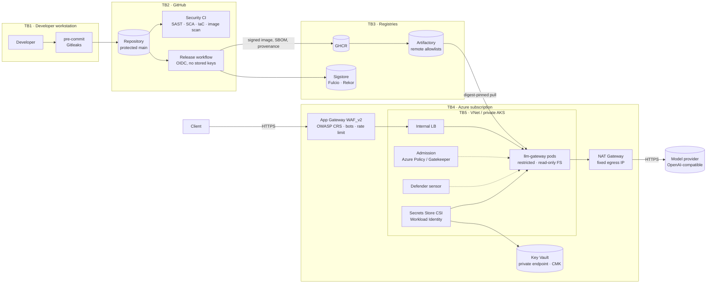

# Threat model (STRIDE)

Scope: the LLM gateway, the path from a developer's commit to a running
pod, and the Azure platform it runs on. Method: draw the system, mark the
trust boundaries, apply STRIDE to each element that crosses one, map every
threat to a control that exists in this repository — or record it as a
residual risk.

## Architecture and trust boundaries

| Boundary | What crosses it | Why it is a boundary |
|---|---|---|
| TB1 → TB2 | commits | a developer machine is not trusted to keep secrets out |
| TB2 → TB3 | images, signatures, attestations | a registry is where substitution happens |
| TB3 → TB5 | image pulls | the cluster must run only what CI built |
| Internet → TB4 | user prompts | untrusted input, including prompt injection |
| TB5 → Key Vault | the LLM API key | the one real secret in the system |
| TB5 → model provider | prompts and replies | data leaves our control; replies are untrusted |

## STRIDE per element

### Client → WAF → gateway (the request path)

| STRIDE | Threat | Control | Where |
|---|---|---|---|
| **S**poofing | Caller fakes its IP to dodge rate limits | WAF groups by `ClientAddr`; app trusts `X-Forwarded-For` only behind the WAF | `modules/app-gateway`, `components/aks-ingress` |
| **T**ampering | Prompt injection overrides server instructions | No caller `system` role; injection heuristics; model has no tools | `app/schemas.py`, `app/guardrails.py` |
| **R**epudiation | Abuse cannot be traced | Guardrail audit lines (control, types, client — never text); WAF logs to Log Analytics | `app/main.py`, `modules/monitoring` |
| **I**nformation disclosure | PII sent to a third-party model; system prompt or secrets echoed back | Input + output redaction; canary-based leak withholding; generic 502 | `app/guardrails.py` |
| **D**enial of service | Flooding, huge prompts, token-burning | WAF rate limit, app per-client limit, size and `max_tokens` caps, 2 replicas + PDB | WAF, `app/schemas.py` |
| **E**levation of privilege | Exploit in the app → node or cluster | Non-root UID, read-only FS, no capabilities, seccomp, PSA/Azure Policy *restricted*, default-deny NetworkPolicies | `deploy/k8s/base` |

### Commit → registry → cluster (the supply chain)

| STRIDE | Threat | Control | Where |
|---|---|---|---|
| **S**poofing | Image pushed by someone other than the release workflow | Cosign keyless: certificate identity pinned to `release.yml@refs/heads/main`; verified at admission | `release.yml`, `platform/local` |
| **T**ampering | Tag re-pointed or layer swapped in the registry | Deploy by **digest** only; signature verification; Artifactory no-overwrite (per file — compensated by digest + signature) | overlays, step 3 |
| **T**ampering | Malicious dependency | Hashed lockfiles (`--require-hashes`), pip-audit gate, Dependabot, actions pinned by SHA | `apps/llm-gateway`, CI |
| **R**epudiation | "Who built this?" | SLSA provenance + SBOM attestations, Rekor transparency log | `release.yml` |
| **I**nformation disclosure | Secret committed to Git | Gitleaks pre-commit **and** CI gate | `.pre-commit-config.yaml`, CI |
| **D**enial of service | Upstream registry outage or deletion | Artifactory remote cache as the single entry point | step 3 |
| **E**levation of privilege | Over-privileged CI token | `permissions: {}` by default, per-job grants; OIDC instead of stored credentials | workflows |

### Platform (Azure)

| STRIDE | Threat | Control | Where |
|---|---|---|---|
| **S**poofing | Stolen kubeconfig used from the Internet | Private API server; Entra ID + Azure RBAC; local accounts disabled; access via `command invoke` | `modules/aks` |
| **T**ampering | Drift or manual change in the portal | Terraform as the only writer; remote state with versioning and lock; Azure Policy `deny` | `infra/terraform` |
| **R**epudiation | Untraceable control-plane actions | AKS, Key Vault and WAF diagnostic logs to Log Analytics | `modules/monitoring` |
| **I**nformation disclosure | LLM key read from Git, image, state, env or a K8s Secret | Write-only Terraform value; Key Vault via CSI + Workload Identity; private endpoint; CMK + KMS etcd encryption | step 8 |
| **D**enial of service | Destroyed state or vault | State: GZRS, soft delete, `CanNotDelete` lock. Vault: purge protection | `bootstrap`, `modules/key-vault` |
| **E**levation of privilege | Container escape, crypto-miner, reverse shell | Defender for Containers sensor; Falco rules locally; Defender CSPM attack paths | step 6, step 9 |

## Residual risks (accepted, with the reason)

| Risk | Why accepted here | What production would add |
|---|---|---|
| Injection heuristics are bypassable (paraphrase, encoding, other languages) | Deterministic and free; the real limit is that the model has no agency | A classifier (Azure AI Content Safety Prompt Shields), human review for high-impact actions |
| Rate limit is per pod | WAF limit is the primary layer | Shared limit in APIM or Redis |
| Terraform applied from an operator workstation (IP-allowlisted state) | Trial subscription, single operator | CI apply with OIDC federation, plan review, approvals per environment |
| Policy-excluded namespaces (`kube-system`, `aks-command`) are admission blind spots | Required by AKS components | Runtime detection covers them; RBAC limits who can create pods there |
| Dev system node runs without the Defender collector (CPU) | 4-vCPU trial quota | D4 system nodes (already in staging and prod) |
| Defender test alert not observed end to end on the trial | Sensor healthy, plan active; alert did not surface | Verify on a paid subscription; alert routed to SIEM (Sentinel) |
| Self-signed TLS on the WAF listener | No public domain in a lab | Key Vault-integrated CA certificate |
| Local-only Gatekeeper/Kyverno signature verification | AKS uses Azure Policy image allowlist (digest-pinned) | Ratify + Azure Policy for signature verification on AKS |

## How to use this document

Re-run the exercise when a boundary changes: a new data store (RAG
index → LLM08), a tool given to the model (→ LLM06, excessive agency), a
new environment, or a new way in. A new row without a control is a
backlog item, not a footnote.
